# Nexo Assist

Assistente de service desk de TI da Nexo: o funcionário descreve o problema numa conversa, o agent consulta os
chamados dele, busca na central de ajuda, monta um rascunho de chamado com a prioridade do Anexo A e, quando
precisa, passa a conversa para um analista com um resumo do caso. Cada turno deixa registrado **o que o agent
entendeu, o que fez, por quê e com que confiança** — e o funcionário e o analista conseguem ler isso na tela.

Stack: Next.js 16 (App Router) · React 19 · Mastra + AI SDK 7 · DeepSeek (`deepseek-flash`) · Postgres + Drizzle ·
serviço de chamados legado simulado em Hono · Vitest + Playwright.

---

## 1. Como rodar

Pré-requisitos: Node 22+, pnpm 12 (`corepack enable` usa a versão do `packageManager`), Docker.

```bash
cp .env.example .env          # funciona como está: modelo roteirizado, sem chave
docker compose up -d db       # Postgres 16 na 5432 (cria nexo, nexo_test e nexo_e2e)
pnpm i
pnpm db:migrate
pnpm db:seed
pnpm dev                      # web em http://localhost:3000 + serviço de chamados na 4001
```

Porta 3000 ocupada? `PORT=3005 pnpm dev`.

**Com o modelo real:** no `.env`, `LLM_PROVIDER=deepseek` e `DEEPSEEK_API_KEY=...`. Para medir custo, preencha
`LLM_PRICE_IN_CENTS_PER_MTOK=30` e `LLM_PRICE_OUT_CENTS_PER_MTOK=120` (preço oficial do `deepseek-flash`, ver §6).

**Tudo em containers** (web + chamados + banco, como em produção):

```bash
docker compose --profile full up --build      # http://localhost:3000
pnpm smoke http://localhost:3000 --restart    # login, conversa, rascunho e persistência após restart
```

### Usuários do seed

Todos os usuários do seed entram com a senha **`nexo2026`**.

| Pessoa | E-mail | Papel | O que tem no seed |
|---|---|---|---|
| Ana Souza | `ana.souza@nexo.com.br` | Funcionária (Financeiro) | INC-20311 vencido, INC-20298 aberto (SharePoint), REQ-10442 (monitor), chamados antigos resolvidos |
| Carla Mendes | `carla.mendes@nexo.com.br` | Funcionária (Comercial) | Conversa já transferida, esperando um analista |
| Diego Ramos | `diego.ramos@nexo.com.br` | Funcionário (Marketing) | Sem histórico — bom para começar do zero |
| Rafael Lima | `rafael.lima@nexo.com.br` | Analista N2 | Console do analista |
| Juliana Costa | `juliana.costa@nexo.com.br` | Analista N1 | Console do analista |

Roteiro curto para ver tudo: entre como **Ana** e mande *"Meu notebook não conecta na VPN, erro 809"* → responda
*Windows 11* → *"Só eu, tenho reunião às 14h"*. Clique na linha de status do agent para abrir o painel
**"Por que o Nexo fez isso?"**. Depois mande *"quero falar com um analista"*, entre como **Rafael** em outra
janela e assuma a conversa.

---

## 2. Arquitetura

```
┌─────────────────────────────── web (Next.js 16, um processo) ───────────────────────────────┐
│  UI (React)                  │  API /api/v1 (Route Handlers)         │  Agent (Mastra)        │
│  /login                      │  POST conversations/:id/messages      │  runTurn               │
│  /atendimento  (funcionário) │       → stream (AI SDK UI messages)   │   ├ tools (6)          │
│  /perfil · /chamados         │  POST drafts/:id/confirm (idempotente)│   ├ decisão declarada  │
│  /console      (analista)    │  GET  conversations (fila) · claim ·  │   ├ rules/ (puras)     │
│                              │       release · close · handoffs      │   ├ triggers/          │
│                              │  GET  events (SSE)  · ai/runs/:id     │   └ guardrails/        │
└──────────────────────────────┴───────────────────────────────────────┴───────────┬────────────┘
             │ Drizzle                                                             │ HTTP tipado:
             ▼                                                                     │ retry curto +
   ┌──────────────────────────┐                        ┌───────────────────────────▼──────────┐
   │ Postgres                 │◄───── schema tickets ──│ services/tickets (Hono, processo     │
   │  app: conversas, mensagens│                        │ próprio): GET/POST/PATCH /tickets,   │
   │  rascunhos, passagens,   │                        │ /transfer, idempotência, falhas      │
   │  ai_agent_runs, llm_calls│                        │ simuladas e /_chaos/outage           │
   │  event_log · mastra      │                        └──────────────────────────────────────┘
   └──────────────────────────┘
```

- **O serviço de chamados é um processo separado** porque o PRD diz que ele é legado e instável. Assim a
  instabilidade é real: dá para derrubá-lo (`POST /_chaos/outage?seconds=30`) e ver a UI avisar com honestidade,
  guardar o rascunho e confirmar depois. O agent só fala com ele pela borda `lib/agent-engine/edge/tickets`
  (retry curto, disjuntor, erros tipados).
- **Pastas:** `lib/rules` (Anexo A em funções puras) · `lib/agent-engine` (agent, tools, `triggers`, guardrails,
  borda do LLM e dos chamados) · `lib/conversations` (estado agent × analista, passagem) · `lib/contracts`
  (Zod compartilhado entre API, UI e serviço) · `services/tickets` · `app/` (telas e rotas).
- **Língua:** o código (nomes, arquivos, tools que o modelo vê, logs) é em inglês; o que a pessoa lê (telas,
  URLs, mensagens da API), o prompt do agent, os comentários e os nomes dos testes ficam em português.
- **Tempo real do console:** SSE sobre o `event_log` (com `Last-Event-ID`), caindo para polling se o
  `EventSource` falhar.

---

## 3. Como o agent decide o que fazer

A divisão é: **o modelo interpreta, o código decide o que tem regra.**

| Quem | Decide o quê |
|---|---|
| Modelo (DeepSeek) | O que o funcionário quer, que pergunta fazer, que artigo serve, que dados pôr no rascunho |
| Código (`lib/rules`) | Prioridade e prazo (Anexo A), horário útil, chamado vencido, janela de reabertura de 7 dias, transições agent × analista |
| Código (`triggers/`) | Quando transferir: pedido explícito, Crítica, confiança abaixo de 0,6, limite de 30 mensagens da sessão, teto de gasto do dia; oferta de analista para chamado vencido |
| Código (`guardrails/`) | O agent prometeu um analista sem transferir → o sistema transfere. Disse que criou um chamado → aviso "o chamado ainda não foi criado". Fonte que nenhuma tool retornou → descartada. Rascunho de chamado novo com outro aberto na mesma categoria → recusado até o agent atualizar o existente ou dizer que é outro problema |
| Funcionário | Criar, atualizar ou reabrir chamado: **só o clique em Confirmar** cria (idempotente) |

**Tools** (identidade sempre da sessão, nunca do modelo): `search_articles`, `list_my_tickets`,
`get_ticket`, `build_draft` (o modelo informa *quem é afetado / impede de trabalhar / compromisso hoje*; a
prioridade é calculada), `offer_options` (opções rápidas), `transfer_to_analyst`.

**Um turno** (`lib/agent-engine/agent/run-turn.ts`):

1. Portão: se um analista está com a conversa, o modelo não é chamado. Pedido explícito de analista, limite
   da sessão e teto de gasto também transferem sem chamar o modelo.
2. O agent roda com até 6 passos de tool; cada tool emite a ação (com tempo e resultado) e os cards no stream.
3. **Decisão declarada:** uma chamada curta e estruturada (Zod) registra entendimento, ação, confiança, porquê,
   regras e fontes. Se o modelo devolver lixo, a decisão fica `null` ("não registrada") — ausente ≠ vazia.
4. Ajustes determinísticos: fontes vêm das tools (não do texto do modelo); a ação vem do que as tools fizeram
   (transferir vence; rascunho define criar / atualizar / reabrir); dúvida respondida sem fonte tem confiança
   limitada a 50%.
5. Gatilhos e guardrails; tudo fica em `ai_agent_runs` + `llm_calls` (tokens, custo, latência).

---

## 4. Como garanti a qualidade das decisões

Duas perguntas diferentes, dois instrumentos:

- **O pipeline faz o que deve?** Testes com um **modelo roteirizado** (`lib/agent-engine/edge/llm/scripted-model.ts`):
  um `LanguageModelV4` determinístico que segue roteiros por mensagem (inclusive tool calls, falhas e decisões
  inválidas). Ele existe para que unitários, integração e E2E rodem sem chave, sem custo e sem variação — eles
  provam regras, tools, guardrails, persistência e UI, não o julgamento do modelo.
- **O modelo julga bem?** **Evals com o modelo real** (`evals/`): 14 cenários das histórias do PRD, cada um 3×,
  contra o pipeline real. Critérios verificáveis no banco (tools chamadas, ação, rascunho, prioridade, fontes,
  transferência) — sem juiz LLM.

### Pirâmide de testes

| Camada | Comando | O que cobre | Resultado |
|---|---|---|---|
| Typecheck + lint | `pnpm typecheck && pnpm lint` | TS estrito, React hooks | 0 erros, 0 avisos |
| Unitários | `pnpm test` | Anexo A, prazos em horário útil, reabertura, máquina de estados, gatilhos, guardrails, busca, contratos, componentes | **261/261** (31 arquivos) |
| Integração | `pnpm test:int` (Postgres) | `runTurn` com memória e banco reais, API com sessão e papéis, serviço de chamados, idempotência, SSE | **134/134** (14 arquivos) |
| E2E | `pnpm test:e2e` (Playwright) | As histórias do PRD de ponta a ponta: abrir, consultar, complementar, transparência, privacidade, fora de escopo, transferência e console, instabilidade do legado, limite da sessão, continuidade, conta e controles do console, histórico | **45/45** (~1,5 min) |
| Evals | `pnpm eval` (DeepSeek) | Julgamento do modelo nas 14 histórias | **40/42 (95%)** |

`pnpm check` roda typecheck, lint e unitários juntos. Números da última rodada completa, em 04/11/2026.

### Resultado dos evals (`deepseek-flash`, 14 cenários × 3)

Primeira rodada: **30/39 (77%)**. Os erros viraram correções no código (com teste antes) e ajustes de prompt
(um commit por ajuste, com antes/depois): fonte verificada num turno anterior passou a contar; ação da decisão
passou a seguir o que as tools fizeram; update/reopen montam o rascunho sem perguntar; caso crítico transfere no
mesmo turno. Com os 13 cenários originais chegou a **39/39 (100%)**; com o cenário novo `resolved-tickets`
(histórico), **41/42 (98%)**. A rodada atual, depois da checagem de duplicidade e dos nomes das tools em inglês
(`search_articles`, `build_draft`…), deu **40/42 (95%)**, com uma falha em cada um de dois cenários: em
`vpn-809-win11` a chamada de decisão não devolveu JSON válido (o rascunho saiu certo), e em `monitor-request` o
rascunho já tinha sido montado no turno anterior e o agent só confirmou os dados. Com 3 repetições por cenário,
uma falha a mais está dentro da variação entre rodadas. Tabela completa em
[`evals/resultados.md`](evals/resultados.md).

---

## 5. Transparência

Cada mensagem do agent tem uma **linha de status** com as ações reais do turno ("✓ consultou seus chamados ·
✓ buscou na central"), que mostra spinner durante o stream e ⚠ quando o sistema de chamados está lento e o agent
está tentando de novo. Clicar nela abre o painel **"Por que o Nexo fez isso?"**:

- **Entendi que…** — resumo e as palavras do funcionário entre aspas.
- **Então eu…** — a ação e uma barra de confiança (verde ≥ 80%, amarela 60–80%, vermelha < 60%).
- **Porque…** — o porquê em linguagem simples e as regras aplicadas (ex.: "Alta: impede uma pessoa de trabalhar
  ou há compromisso no mesmo dia · prazo 4 horas úteis").
- **Consultei** — cada tool com resultado e tempo; artigos e chamados citados.
- Rodapé: modelo · tokens · custo · latência.

No **console do analista** a mesma trilha aparece em cada mensagem do agent, e a passagem vem com um briefing
(palavras do funcionário, leitura do agent, o que já foi tentado, confiança, chamado em foco e prazo).

| Painel de decisão | Console — conversa transferida |
|---|---|
| 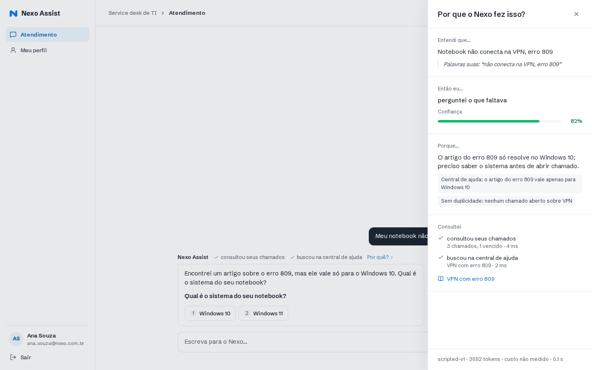 | 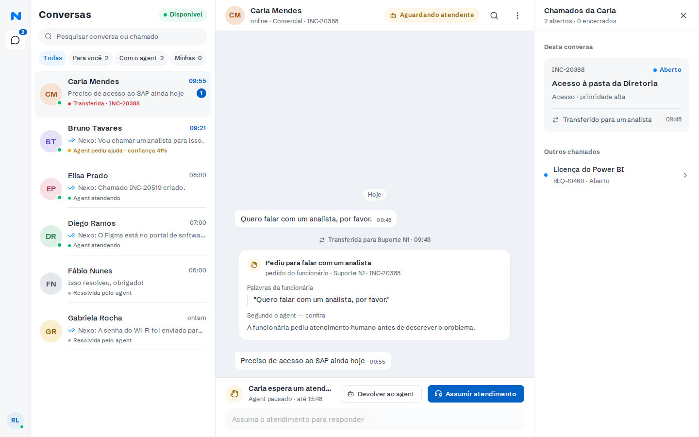 |

---

## 6. Modelo e custo por conversa

**DeepSeek `deepseek-flash`** via `@ai-sdk/deepseek` no Mastra. Escolhido por custo baixo e bom uso de tools em
português; `MODEL_ID` e `LLM_PROVIDER` são trocáveis por env (a borda `edge/llm` isola o provedor).

Custo por conversa, medido nos evals: **≈ 11.800 tokens de entrada e 1.100 de saída** (média das 42 conversas,
1 a 3 turnos cada, incluindo a chamada de decisão de cada turno). Com o preço oficial do `deepseek-flash`
(nov/2026, horário de pico, entrada sem cache: US$ 0,30 / US$ 1,20 por milhão de tokens):

| | Entrada | Saída | Total por conversa |
|---|---|---|---|
| Pico, sem cache (teto) | US$ 0,0035 | US$ 0,0013 | **≈ US$ 0,005 (0,49 ¢)** |
| Fora do pico | US$ 0,0018 | US$ 0,0007 | ≈ US$ 0,0024 |

O cache de prefixo da DeepSeek (instruções e histórico) baixa o custo real abaixo do teto. Com os preços no
`.env`, cada chamada grava `cost_cents` em `llm_calls` e o painel mostra o custo do turno.

---

## 7. Principais trade-offs

- **Busca na central sem embeddings:** palavras-chave com pesos (3× tags, 2× título, 1× corpo), corte de ruído e `applies_to`. Com
  uma dúzia de artigos isso acerta e é explicável; com centenas, iria para busca semântica.
- **Horário útil sem feriados:** seg–sex, 8h–18h, America/Sao_Paulo. Feriados ficariam numa tabela.
- **Rate limit em memória** (janela deslizante): vale para uma instância, que é o deploy. Com réplicas, iria
  para o Postgres ou Redis.
- **DeepSeek e privacidade:** o texto das conversas vai para a API da DeepSeek. Para dados sensíveis de verdade,
  trocar por um provedor com contrato de retenção zero (o provedor é uma env).
- **Chamada extra de decisão por turno:** custa tokens a mais (já incluídos no custo da §6), mas garante uma decisão estruturada e
  validada em todo turno, em vez de depender de o modelo lembrar de chamar uma tool opcional.
- **Sessão de 30 mensagens:** o limite existe para o custo do modelo. Ao bater 30, a conversa vai para um analista
  com todo o histórico, e as mensagens para o analista não contam no limite — o funcionário não fica sem
  atendimento.
- **Senhas:** o banco guarda só o hash (scrypt do `node:crypto`, salt de 16 bytes por usuário, formato
  `scrypt$N$r$p$salt$hash` na coluna `users.password_hash`). O login confere com `timingSafeEqual` e responde
  igual para e-mail inexistente e senha errada ("E-mail ou senha incorretos"), inclusive no tempo: e-mail
  inexistente também paga uma conferência de hash. Usuário sem hash não entra. A senha não vai para log nem
  auditoria. Todos os usuários do seed têm a mesma senha de demonstração; "Esqueci minha senha" e "Redefinir senha"
  continuam simulados. Num banco anterior à coluna, o start do container define a senha de demonstração para os
  usuários do seed que estão sem hash.

### Divergências do protótipo (`referencias/nexo.pen`)

- "Encaminhei para o Suporte N2… em até **2 h úteis**" e "Agent pausado · até 12:05": seguimos o Anexo A — o
  prazo da passagem é o da prioridade do chamado em foco (sem chamado: Alta, 4 h úteis).
- A vitrine do login diz "abri o chamado"; no produto o chamado só é criado pelo clique em Confirmar. A vitrine
  é ilustrativa, assim como os números dela ("8 s primeira resposta", "72% resolvidos sem fila", "6 analistas
  online").
- A Tela 5 tem 1567 px de largura no protótipo (acidental); foi implementada no grid de 1440 px da Tela 4.
- REQ-10442 aparece "há 2 dias" em vez de "há 1 semana", para não cair exatamente no limite do prazo.
- O seletor de chamados ordena pela última atualização, não pela ordem ilustrativa do protótipo.
- "digitando…" na lista do console não foi implementado.
- **Adição:** no protótipo o avatar do analista, no rail do console, não faz nada. Aqui ele abre um menu com nome,
  e-mail, nível (N1/N2), "Meu perfil" (`/console/perfil`, o mesmo perfil do funcionário mais o nível de suporte) e
  "Sair".
- **Adição:** controles do protótipo que não tinham comportamento definido passaram a funcionar no console:
  - a lupa do topo busca nas mensagens da conversa aberta ("1 de 3", Enter/Shift+Enter, Esc fecha);
  - as linhas de "Outros chamados" abrem o detalhe do chamado (dados e histórico do legado, via
    `GET /tickets/:code/events`).
  - "Disponível" ficou como selo, sem cara de botão: a disponibilidade não muda a fila, porque todos os analistas
    veem todas as transferências.
- **Adição:** a busca da lista ("Pesquisar conversa ou chamado"):
  - ignora acento e caixa;
  - casa nome no começo da palavra;
  - procura em todas as mensagens e nos códigos e títulos dos chamados do funcionário (pelo serviço de chamados,
    `GET /tickets/search`; se ele cair, a busca segue só com nome e mensagens);
  - termos de até 3 letras só valem como palavra inteira no texto (`ana` não acha "analista");
  - resultados por nome vêm primeiro, e cada resultado mostra por que apareceu (o chamado ou o trecho da mensagem).
- **Adição — histórico:**
  - tela **Meus chamados** (`/chamados`), com abas "Em andamento" e "Resolvidos";
  - o detalhe usa o mesmo card do chat, mais responsável, prazo e o histórico do legado;
  - "Falar sobre este chamado" abre o atendimento com `Sobre o INC-…: ` no composer;
  - no chat, "meus chamados resolvidos/antigos" lista só os encerrados (`status: closed` na tool);
  - "Carregar mensagens anteriores" no topo do chat e da conversa do console. O cursor é o id da mensagem, para não
    pular mensagens gravadas no mesmo instante.
- "Manter conectado neste computador" agora vale: desmarcado, o cookie é da sessão do navegador.

### Telas (capturas do E2E, `e2e/visual.spec.ts`)

| Tela do protótipo | Implementação |
|---|---|
| 1 — Identificação | 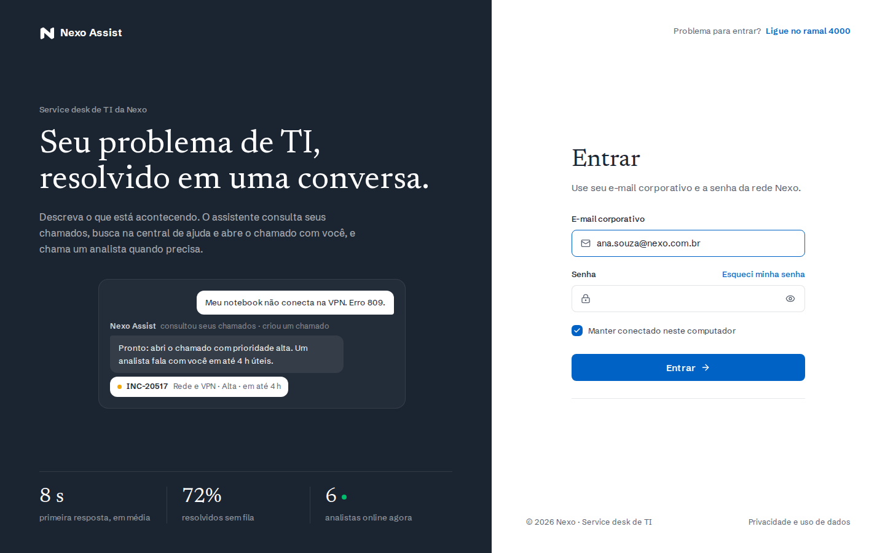 |
| 2 — Chat, novo chamado | 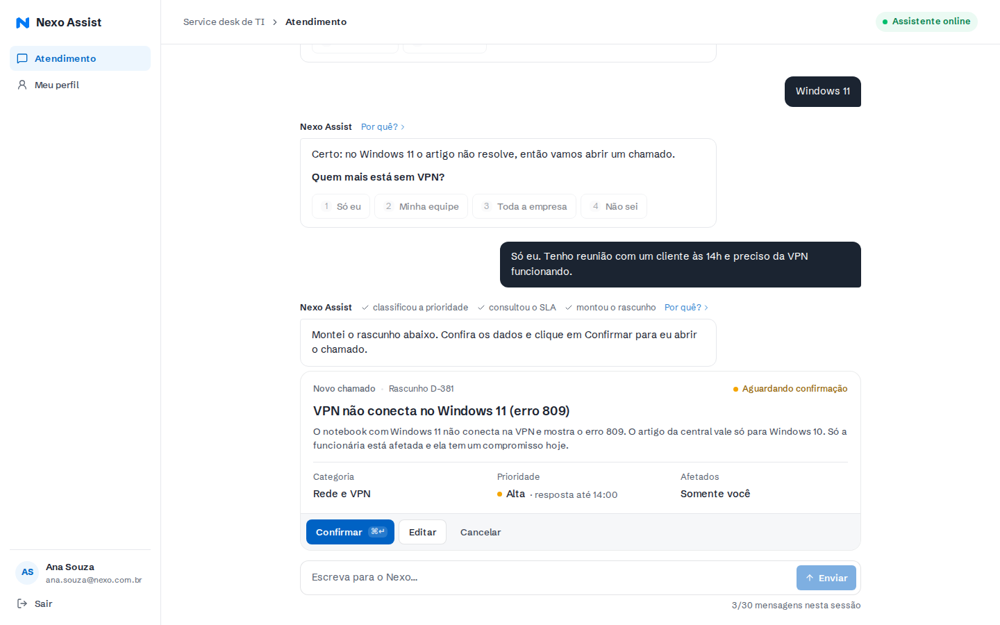 |
| 3 — Chat, consulta e transferência | 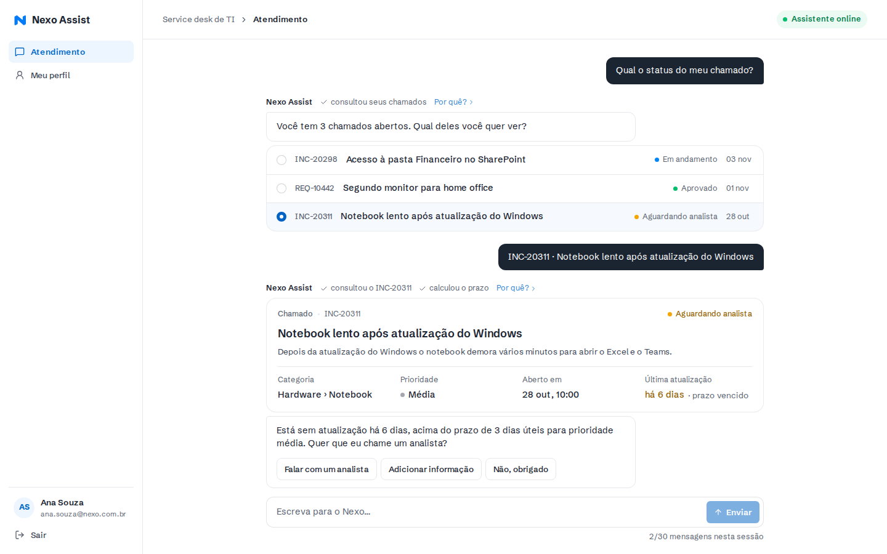 |
| 4 — Console, conversa transferida |  |
| 5 — Console, atendimento assumido | 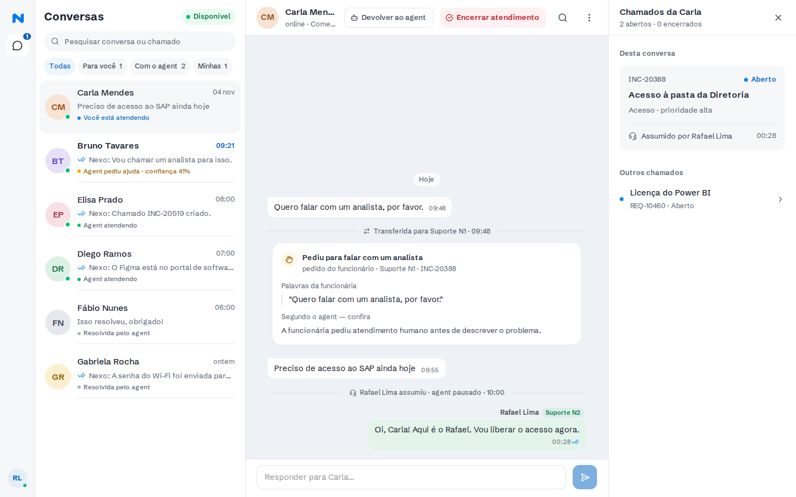 |
| 6 — Meu perfil | 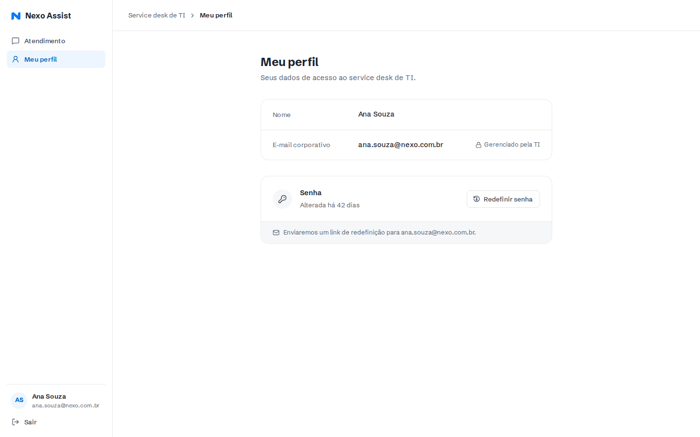 |
| Adição — menu do analista | 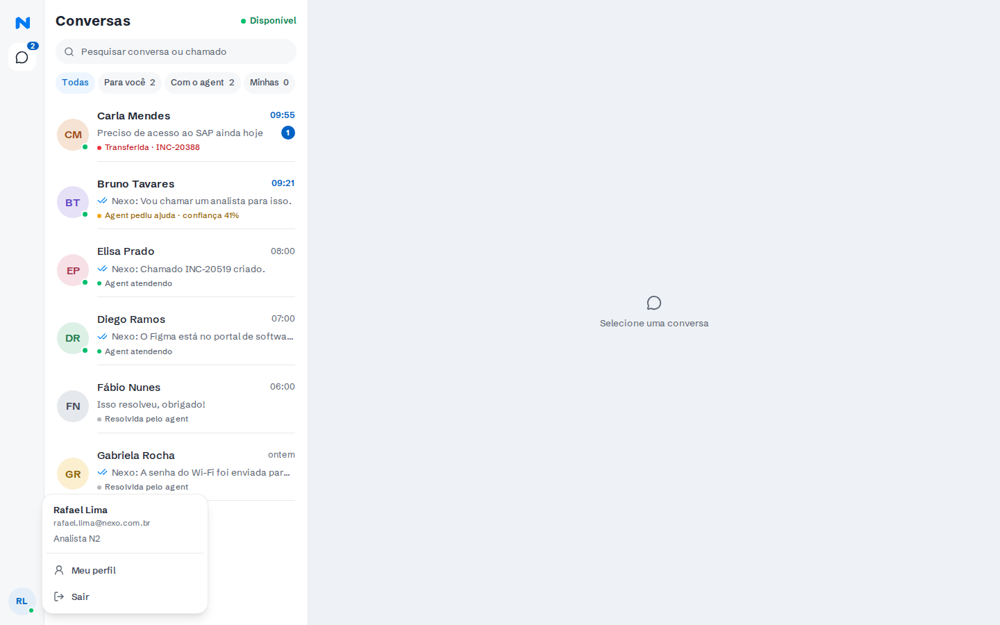 |
| Adição — perfil do analista | 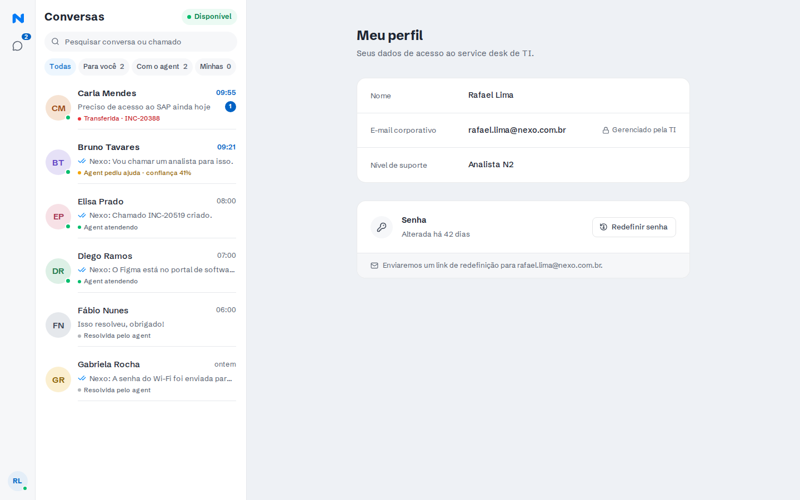 |
| Adição — busca na lista e na conversa | 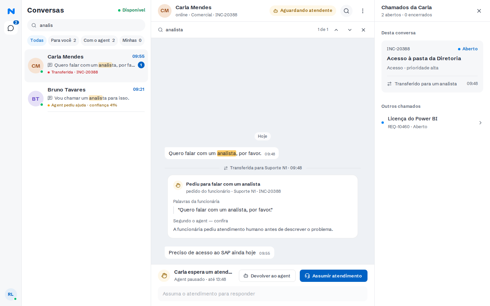 |
| Adição — detalhe do chamado | 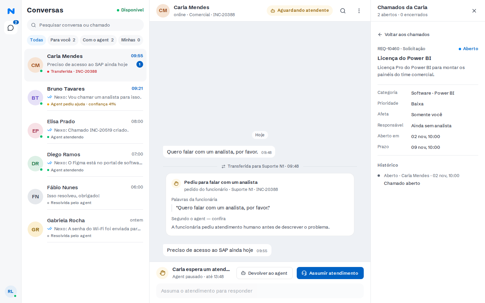 |
| Adição — Meus chamados | 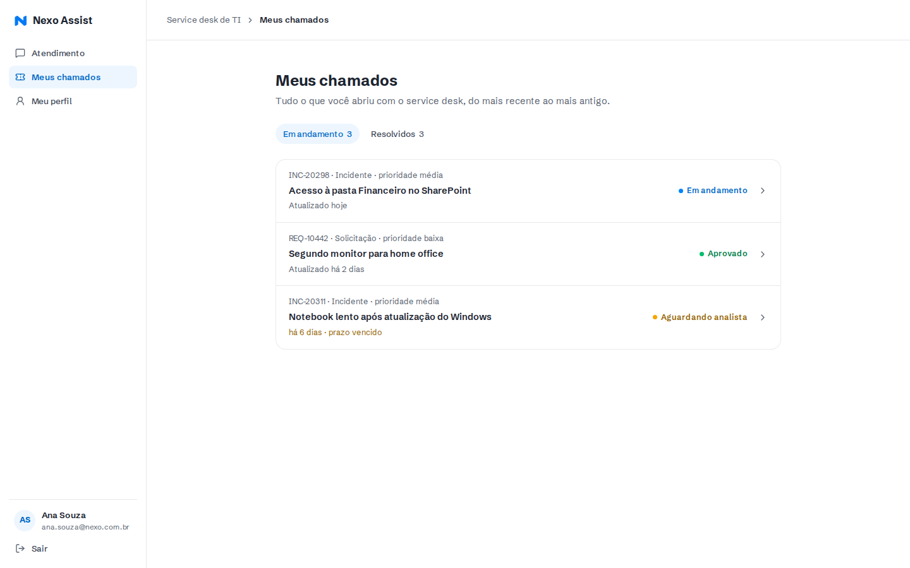 |
| Adição — detalhe de um chamado (funcionário) | 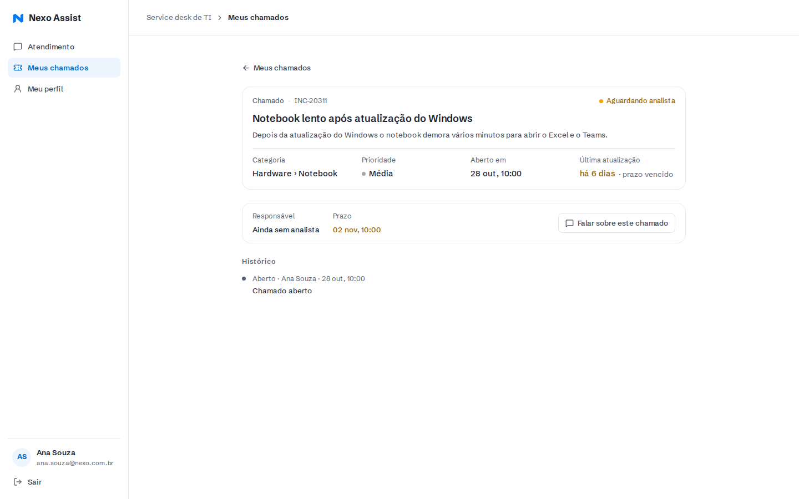 |

---

## 8. O que faria com mais tempo

- Busca semântica na central, com avaliação de recall.
- Feriados no cálculo de prazo; SLA pausado fora do horário visível na UI.
- Rate limit e disjuntor compartilhados (Redis) para rodar mais de uma réplica.
- Paginação na fila do console e busca com índice (trigram) quando houver muitas conversas; "digitando…"; o `EventSource` voltar para SSE depois de cair para
  polling.
- Evals rodando no CI em PRs que mexem no prompt, com orçamento fixo.
- Login real (SSO da empresa) no lugar da senha local, ou ao menos troca e redefinição de senha de verdade.

---

## 9. Deploy

- **Imagens** buildadas no GitHub Actions e publicadas no GHCR (`.github/workflows/images.yml`); o servidor só
  faz `pull` — nada de `next build` na VPS.
- **Produção:** `docker-compose.prod.yml` com `nexo-web` (384 MB) e `nexo-tickets` (128 MB, sem porta
  publicada), atrás do Caddy da VPS, que termina o HTTPS. Banco: Postgres gerenciado. O web aplica as migrations
  no start.
- **Segredos:** a chave do modelo e o `SESSION_SECRET` ficam só no `.env` do servidor, nunca no repositório nem no
  cliente; o navegador só fala com a API do app. Gere um segredo novo para produção (`openssl rand -base64 48`) —
  o do `.env.example` é público.
- **Proteção:** rate limit de mensagens por funcionário (`RATE_LIMIT_PER_MINUTE`, 429 com `Retry-After` antes de
  abrir o stream) e de login por IP (o IP vem da entrada do `X-Forwarded-For` que o Caddy acrescentou,
  `TRUST_PROXY_HOPS=1`; o que o cliente escreve à esquerda é ignorado); **teto diário de gasto** (`LLM_DAILY_BUDGET_CENTS`, exige os dois `LLM_PRICE_*`; sem eles o app não sobe) — acima dele o agent
  para de chamar o modelo e transfere para um analista; cabeçalhos de segurança (`X-Frame-Options: DENY`,
  `nosniff`, `Referrer-Policy`, `Permissions-Policy`) e sem `X-Powered-By`.
- **CI** (`.github/workflows/ci.yml`): typecheck + lint + unitários, integração com Postgres, E2E.
